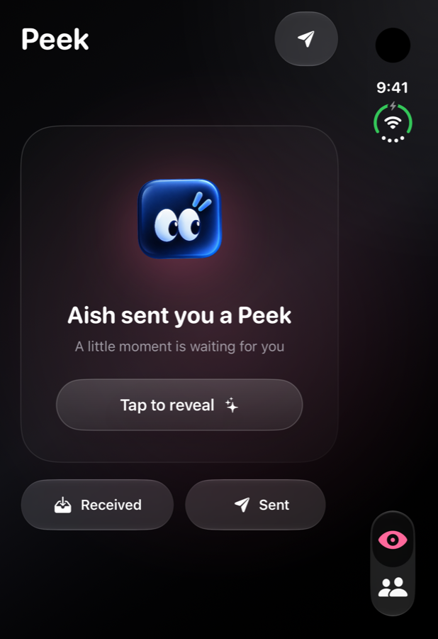
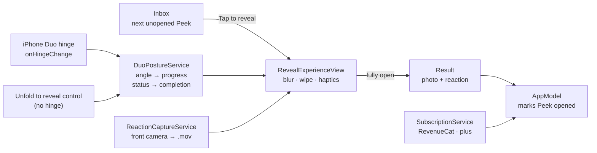

<div align="center">


# PEEK

**There's only one way to see it.**

A friend sends a photo. You open it by unfolding your iPhone Duo, and they get your real reaction back, not an emoji.

[How a Peek works](#how-a-peek-works) · [What's real today](#whats-real-today) · [Under the hood](#under-the-hood) · [Run it](#run-it) · [Verification](#verification) · [Find the code](#find-the-code)

<sub>An iPhone Duo app built with SwiftUI, AVFoundation, the iOS 27.1 hinge API, and RevenueCat.</sub>

<br />



<sub>The real inbox, captured from the outer screen of the iPhone Duo simulator. The black circle at the top right is the screen's camera cutout.</sub>

</div>

## How a Peek works

1. **A Peek arrives.** The inbox shows who sent the next unopened Peek. Nothing about the photo is visible yet.
2. **Tap to reveal.** Peek asks for the front camera and starts recording your reaction. The permission prompt says exactly that: *"Peek records your reaction only after you tap Reveal."*
3. **Unfold the phone.** The photo follows the hinge. It wipes in from the left, sharpens from a heavy blur, and brightens as the Duo opens. A soft haptic marks the first movement, and the caption appears near the end.
4. **Fully open = revealed.** A success haptic plays, recording continues for 1.6 seconds to catch the moment, then stops.
5. **Your reaction goes back.** The result screen shows the photo with your reaction as a picture-in-picture. **Next Peek** moves on; when the inbox is empty you get a small celebration instead.
6. **See how they took it.** Under **Sent**, each friend who reacted has a play button. Today it opens a placeholder player; playing the real clip needs the backend described below.

No Duo? The reveal screen shows an **Unfold to reveal** control that plays the same motion, so the flow works on the simulator and on other iPhones.

## What's real today

Peek is a working prototype. The reveal mechanics are real; the social layer is demo data.

| Real | Demo or not built yet |
| :--- | :--- |
| The reveal follows the actual hinge angle and status on iPhone Duo (iOS 27.1). | Friends and incoming Peeks are built-in demo data. The photos are drawn illustrations. |
| The front camera records a real `.mov` of your reaction while you unfold. | There is no backend: reactions are not uploaded or delivered to the sender. |
| Camera permission, denial, and missing-camera cases fall back cleanly to a labeled **Simulated reaction**. | The sender's reaction player shows a placeholder, not the recorded video. |
| RevenueCat loads offerings and tracks the `plus` entitlement. | There is no paywall UI yet; the subscription state is not used by any screen. |
| **Add friend** updates the friends list for the session. | Friends are not saved between launches. |

## Under the hood



### The hinge is the button

[`DuoPostureService`](Peek/Services/DuoPostureService.swift) reads `DeviceHingeContext` through SwiftUI's `onHingeChange`. The **angle** drives the animation: while the phone is partly open, progress is the angle divided by 180°, held between 8% and 96%. Only the hinge's own **fully open** status completes the reveal. That split keeps the photo moving smoothly with your hand while making sure a slightly-short unfold can't end it early.

**Tradeoff:** the hinge API needs iOS 27.1. On earlier systems the observer is skipped and only the demo control can open a Peek.

### A camera with a clear boundary

[`ReactionCaptureService`](Peek/Services/ReactionCaptureService.swift) starts only when the reveal screen opens, records to a temporary file, and stops itself after the reveal. If permission is denied, the camera is missing, or setup throws, it switches to a labeled placeholder instead of failing the reveal. A **REC** badge and a live preview of your face appear as soon as the unfold begins.

**Tradeoff:** the recording stays on the phone and lives in a temp directory; nothing uploads it yet.

### Subscriptions without a hard dependency

[`SubscriptionService`](Peek/Services/SubscriptionService.swift) reads the RevenueCat public SDK key from the `REVENUECAT_API_KEY` scheme variable or a git-ignored `Peek/RevenueCat.plist`. With no key, the app logs one line and runs normally.

## Run it

**Requirements:** Xcode 27.1 or newer. The app targets iOS 27.0; the hinge-driven reveal needs iOS 27.1 on an iPhone Duo or the iPhone Duo simulator.

```bash
git clone https://github.com/taranggoyal70/Peek.git
cd Peek
open Peek.xcodeproj
```

Pick an **iPhone Duo** simulator and run the **Peek** scheme. Swift Package Manager fetches RevenueCat on the first build.

**Optional: subscriptions.** Copy the example and add your RevenueCat public SDK key (it starts with `appl_`):

```bash
cp RevenueCat.plist.example Peek/RevenueCat.plist
```

`Peek/RevenueCat.plist` is git-ignored. You can set `REVENUECAT_API_KEY` in the scheme's environment variables instead.

## Verification

Checked on Nov 17, 2026 with Xcode 27.1 (27A9269):

- **Builds** for the iPhone Duo simulator and for a generic iOS device (unsigned).
- **Runs** on the iPhone Duo simulator. The inbox screenshot above is from that run.

Not yet verified: the reveal on physical iPhone Duo hardware, camera recording on a real device, and RevenueCat purchases. There are no automated tests yet.

## Find the code

```text
Peek/
  PeekApp.swift                     App entry point
  ContentView.swift                 Peeks and Friends tabs
  App/AppModel.swift                Inbox state, opened Peeks, friends
  Models/PeekModels.swift           Peek, Friend, Reaction, and the demo data
  Services/
    DuoPostureService.swift         Hinge angle and status → reveal progress
    ReactionCaptureService.swift    Front-camera reaction recording
    SubscriptionService.swift       RevenueCat entitlement state
  Features/
    Inbox/InboxView.swift           Home screen, next Peek, Received / Sent
    Reveal/RevealExperienceView.swift   The unfold-to-reveal experience
    Reveal/IncomingPeekView.swift   "Sent you a Peek" invitation
    Reactions/SenderReactionsView.swift Who reacted to your Peek
    Friends/FriendsView.swift       Friends list and Add friend
  Components/                       Camera preview, avatars, glass buttons
RevenueCat.plist.example            Template for the git-ignored SDK key file
docs/readme/                        Images used in this README
```

## Credits

Created by [Tarang Goyal](https://github.com/taranggoyal70). Peek is an independent app; RevenueCat and other dependencies keep their own licenses.
